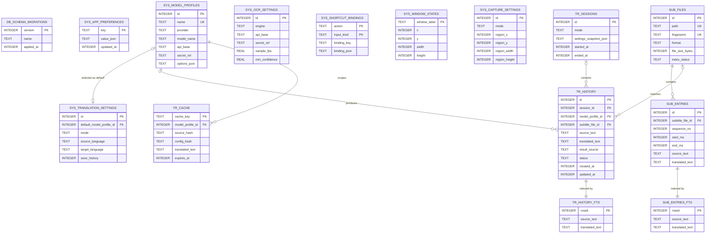

# LoreLingo SQLite 数据库设计

## 1. 设计范围

LoreLingo 当前是单机桌面应用，没有账号、租户或云同步。因此数据库中不引入虚假的 `users` 表，也不在每张表上放 `user_id = 1`。

首版数据库负责持久化：

- 多个翻译模型配置及默认模型
- 翻译、OCR、捕获区域等本地设置
- 键盘和手柄快捷键
- 主窗口、悬浮字幕条的位置与尺寸
- 字幕文件及其索引条目
- 翻译会话、历史记录、收藏和全文检索
- 独立的翻译缓存

运行中的临时状态，例如“正在翻译”、当前请求进度、窗口 HWND，不写数据库。

## 2. 核心原则

### 单机不等于单行配置

真正只有一份的设置使用 `CHECK (id = 1)` 单例表，例如 `sys_translation_settings`。可存在多份的实体使用普通表，例如 `sys_model_profiles`。这样既没有用户概念，又允许用户配置多个模型并切换。

### 强类型表与 JSON 混合

需要校验、关联、筛选的字段使用结构化列。只有低频 UI 偏好和不同引擎的特有选项使用 JSON：

- `sys_app_preferences`：`ui.theme`、历史列表页大小等非核心偏好
- `sys_model_profiles.options_json`：temperature、top_p、额外请求头等供应商差异项
- `sys_ocr_settings.options_json`：OCR 引擎专属参数
- `capture_context_json` / `settings_snapshot_json`：历史审计快照

不要把所有设置塞进一行大 JSON；否则字段约束、局部更新和迁移都会变得困难。

### 密钥不进入 SQLite

`sys_model_profiles.secret_ref` 和 `sys_ocr_settings.secret_ref` 保存系统凭据条目的引用。当前单次翻译使用随机 `translation-<UUID>`，服务命名空间固定为 `com.lorelingo.app`；API Key 本体使用 macOS Keychain 或 Windows Credential Manager 保存，其他平台明确不支持密钥持久化。`options_json` 也不能存放鉴权请求头。SQLite 文件、日志、备份和导出中都不应出现明文密钥。

当前设置表单通过 `TranslationConfigService` 将默认模型的地址、名称、密钥引用与单例翻译设置的模型指针、默认语言放在同一事务中保存，未编辑的配置保留原值。初始化后按需从同一默认模型恢复配置；系统密钥读取不在界面线程执行。更新密钥先暂存新凭据再提交引用，数据库失败保留旧配置；提交后尽力清理不再引用的条目。工具栏临时语言方向和其他尚未接入的设置编辑不属于这条保存链路。

### 历史与缓存分离

`tr_history` 是用户数据，支持浏览、收藏、保留策略和删除；`tr_cache` 是性能数据，可以按 LRU 或到期时间清理。删除历史不应造成缓存失效，清缓存也不应删掉用户历史。

## 3. 模块与命名

表名前缀表达所属模块，使用小写 `snake_case` 和复数表名（`history`、`cache` 等集合名词除外）。普通索引使用 `ix_<table>_<purpose>`，唯一索引使用 `ux_<table>_<purpose>`，触发器使用 `trg_<table>_<purpose>_<event>`。

| 前缀 | 模块 | 包含内容 |
| --- | --- | --- |
| `db_` | 数据库内部管理 | 数据库 migration 版本 |
| `sys_` | 应用级配置 | 模型、翻译、OCR、快捷键、窗口和捕获设置 |
| `sub_` | 字幕库 | 字幕文件、时间轴条目和检索索引 |
| `tr_` | 翻译记录 | 翻译会话、历史、全文检索和缓存 |

前缀仅表示领域边界，不代表独立 SQLite schema；SQLite 主库仍然是一个事务边界。

字段和存储约定：

- 本地主键使用 `INTEGER PRIMARY KEY`；没有“永不复用 rowid”的业务要求时不使用 `AUTOINCREMENT`。
- 外键使用 `<entity>_id`，并显式声明 `ON DELETE` 行为。
- 时间点统一使用 Unix 毫秒整数并以 `_at` 结尾；时长以 `_ms` 结尾；字节数以 `_bytes` 结尾。
- 布尔值使用带 `CHECK (... IN (0, 1))` 的整数；应用内枚举使用带 `CHECK` 的小写文本。
- JSON 字段以 `_json` 结尾，校验 `json_valid`，并在类型固定时校验顶层 JSON 类型。
- 普通表使用 `STRICT`；稳定文本主键或复合主键表按需使用 `WITHOUT ROWID`。
- `db_schema_migrations` 是唯一迁移版本来源，不再同时维护 `PRAGMA user_version`。

### 结构注释

SQLite 没有原生 `COMMENT ON TABLE/COLUMN`。首版 migration 将表说明写在 `CREATE TABLE name (` 后，将字段说明写在字段定义同行。SQLite 会把这些注释保留在 `sqlite_schema.sql` 中，可通过以下语句查看实际建库结构及注释：

```sql
SELECT name, sql
FROM sqlite_schema
WHERE type = 'table' AND name NOT LIKE 'sqlite_%'
ORDER BY name;
```

状态字段在对应列注释中使用 `值=含义` 完整列举；所有时间字段均明确标注单位。JSON 字段约定如下：

| 字段 | 顶层类型 | 内容 |
| --- | --- | --- |
| `sys_app_preferences.value_json` | 任意 JSON 值 | 由 `key` 决定，例如 `"dark"`、20、true 或对象 |
| `sys_model_profiles.options_json` | 对象 | temperature、top_p、max_tokens、非鉴权额外请求头 |
| `sys_ocr_settings.recognition_languages_json` | 数组 | BCP 47 语言字符串，例如 `["en","ja"]` |
| `sys_ocr_settings.options_json` | 对象 | OCR 引擎专属参数 |
| `sys_shortcut_bindings.binding_json` | 对象或 NULL | 键盘 modifiers/code，或手柄 gamepad_id/button |
| `sys_capture_settings.app_selector_json` | 对象或 NULL | platform、executable、bundle_id、title_hint；不保存 HWND |
| `tr_sessions.capture_context_json` | 对象或 NULL | 捕获模式、区域和目标应用快照 |
| `tr_sessions.settings_snapshot_json` | 对象 | 模型、翻译及 OCR 设置快照 |

## 4. ER 图

完整字段版见 [`docs/database-er.md`](database-er.md)，可编辑的 Draw.io 版本见 [`docs/database-er.drawio`](database-er.drawio)。下面保留适合快速浏览的紧凑版本。



配置单例表、快捷键和窗口状态与业务实体没有外键关系，应用启动时独立加载。

## 5. 表职责

| 表 | 职责 | 关键设计 |
| --- | --- | --- |
| `db_schema_migrations` | 记录迁移版本 | 唯一的 migration 版本来源 |
| `sys_app_preferences` | 可扩展的非核心偏好 | 每个 key 一份合法 JSON |
| `sys_model_profiles` | 模型/端点配置 | 可保存多个配置；默认项由 `sys_translation_settings` 唯一指定 |
| `sys_translation_settings` | 当前翻译行为 | `id = 1`，语言使用 BCP 47，如 `en`、`zh-CN` |
| `sys_ocr_settings` | OCR 引擎、云端凭据引用和采样参数 | `id = 1`，识别语言为 JSON 数组 |
| `sys_shortcut_bindings` | 动作到输入的映射 | `(action, input_kind)` 唯一；规范化输入禁止冲突 |
| `sys_window_states` | 各原生窗口的位置尺寸 | 用稳定的 Tauri `window_label`，不用运行时句柄 |
| `sys_capture_settings` | 捕获模式、区域和应用选择器 | 应用选择器保存 exe/bundle id 等稳定信息，不保存 HWND |
| `sub_files` | 字幕文件和索引状态 | path 与内容 fingerprint 都唯一 |
| `sub_entries` | 字幕时间轴与双语文本 | 文件删除时级联删除条目 |
| `sub_entries_fts` | 字幕模糊匹配的候选召回 | FTS5 先缩小候选集，再由应用计算相似度 |
| `tr_sessions` | 一次手动/自动翻译运行 | 保存当时设置快照，便于问题定位 |
| `tr_history` | 每次翻译结果 | 模型/供应商名称冗余快照，配置被删后历史仍可解释 |
| `tr_history_fts` | 原文和译文全文搜索 | FTS5 trigram，适合中英文子串检索 |
| `tr_cache` | 模型翻译结果缓存 | key 包含文本、语言、模型和配置 hash |

## 6. 关键读写流程

### 应用启动

1. Rust 通过系统用户主目录定位 `~/.lore-lingo/lore-lingo.sqlite3`，不使用当前工作目录或应用标识生成的新目录。
   目标库不存在时，从旧 Tauri 应用数据目录的同名数据库迁入；旧库保留，已有目标库优先。
2. 每次连接执行 `PRAGMA foreign_keys = ON`、`PRAGMA journal_mode = WAL`、`PRAGMA busy_timeout = 5000`。
3. 按版本顺序执行 migration。
4. 一次性加载单例设置、模型列表、快捷键和窗口状态到前端状态层。

数据库连接和 migration 只由 Rust 后端管理。Vue 通过窄接口调用，不允许前端拼 SQL。

配置根目录统一为用户主目录下的 `.lore-lingo`，Windows 对应 `%USERPROFILE%\.lore-lingo`。模型、偏好及其他现有数据库记录集中使用同一个数据库；API Key 本体继续保存在系统凭据存储，引用迁入后无需改名。新建 Unix 目录权限为 `0700`、数据库文件为 `0600`。

旧库通过 SQLite 在线备份 API 生成包含 WAL 已提交内容的一致快照。快照在目标目录临时文件中通过完整性、模式和功能校验，合并临时 WAL 后才原子发布；并发启动不得覆盖已创建的目标。失败不创建空库假装恢复成功、不切换回旧目录、不删除原库，可修复原因后再次启动。没有模式变更，既有 migration 不修改。

回退旧版本时，旧版仍会读取保留的原目录数据库，迁入后在新库保存的修改不会自动同步回旧库。如需回退并保留最新数据，应先关闭两个版本，备份两边数据库，再通过 SQLite 一致快照恢复新库到旧目录；不要直接复制使用中的 SQLite 主文件。

### 保存设置

单个设置面板使用一个事务更新相关表，并由应用层显式更新 `updated_at`。多窗口在保存成功后通过 Tauri event 广播“设置已变更”，其他窗口重新加载对应设置。

### 写翻译历史

一次自动翻译开始时创建 `tr_sessions`。每个结果写入 `tr_history`：

- 字幕命中：`result_source = 'subtitle'`，记录 `subtitle_file_id`
- 模型请求：`result_source = 'model'`，记录模型引用和名称快照
- 缓存命中：`result_source = 'cache'`
- 失败请求也写历史，但 `status = 'error'` 且译文为空

用户关闭历史保存时跳过历史写入，但仍可更新 `tr_cache`。

FTS5 trigram 至少需要 3 个字符。1～2 个字符的历史搜索使用带长度限制的 `LIKE` 回退；字幕匹配应忽略过短 OCR 结果，避免低质量候选和全表扫描。

### 历史清理

自动清理仅删除超过 `history_retention_days` 且 `is_favorite = 0` 的记录。删除后可在空闲时执行 FTS optimize；不要在每次删除后执行 `VACUUM`。

## 7. 建议的 Rust 边界

推荐使用 `rusqlite` 的 bundled SQLite，确保 JSON1、FTS5 和 trigram tokenizer 在三个桌面平台行为一致。连接由 `Mutex<Connection>` 或独立数据库 worker 持有，所有写操作使用事务。

首批 Tauri commands 建议控制在以下粒度：

```text
get_settings() -> SettingsSnapshot
save_translation_settings(input)
save_ocr_settings(input)
list_model_profiles() / upsert_model_profile(input) / delete_model_profile(id)
list_shortcuts() / save_shortcut(input)
list_history(query) / set_history_favorite(id, value) / delete_history(ids)
save_window_state(input)
```

不要暴露 `execute_sql`、通用表名或通用 key-value 写接口给 WebView。

## 8. 迁移与后续同步

首版迁移位于 `src-tauri/migrations/0001_initial.sql`。已发布 migration 只增不改；字段变化通过 `0002_*.sql` 继续演进。

如果以后增加账号或云同步，再为需要同步的业务表增加 `public_id`（UUID）、`device_id`、`sync_version` 和删除墓碑。届时账号是同步层的所有者，不需要重构当前所有本地查询，也不应提前在本地库中模拟用户。
