# LoreLingo 数据库 ER 图（完整字段版）

该图与 `src-tauri/migrations/0001_initial.sql` 保持一致。字段注释中的 `JSON object` / `JSON array` 表示 SQLite 中经过 `json_valid` 和顶层类型约束的 `TEXT`；时间字段均为 Unix 毫秒。

```mermaid
erDiagram
    DB_SCHEMA_MIGRATIONS {
        INTEGER version PK "大于 0 的迁移版本"
        TEXT name UK "非空迁移名称"
        INTEGER applied_at "执行时间"
    }

    SYS_APP_PREFERENCES {
        TEXT key PK "偏好键"
        TEXT value_json "JSON any"
        INTEGER updated_at "更新时间"
    }

    SYS_MODEL_PROFILES {
        INTEGER id PK "模型配置 ID"
        TEXT name UK "配置名称"
        TEXT provider "服务商标识"
        TEXT model_name "模型标识"
        TEXT api_base "API 基础地址"
        TEXT secret_ref "系统钥匙串引用"
        TEXT options_json "JSON object"
        INTEGER is_enabled "0 禁用 | 1 启用"
        INTEGER created_at "创建时间"
        INTEGER updated_at "更新时间"
    }

    SYS_TRANSLATION_SETTINGS {
        INTEGER id PK "固定为 1"
        INTEGER default_model_profile_id FK "默认模型"
        TEXT mode "manual | auto"
        INTEGER auto_interval_ms "500 至 10000 ms"
        TEXT source_language "BCP 47 或 auto"
        TEXT target_language "BCP 47"
        INTEGER request_timeout_ms "请求超时"
        INTEGER prefer_subtitles "0 模型优先 | 1 字幕优先"
        INTEGER save_history "0 不保存 | 1 保存"
        INTEGER history_retention_days "NULL 永久保留"
        INTEGER updated_at "更新时间"
    }

    SYS_OCR_SETTINGS {
        INTEGER id PK "固定为 1"
        TEXT engine "system | tesseract | paddleocr | cloud"
        TEXT api_base "云端 OCR 地址"
        TEXT secret_ref "系统钥匙串引用"
        TEXT recognition_languages_json "JSON array BCP 47"
        REAL sample_fps "0 至 30 fps"
        REAL min_confidence "0 至 1"
        INTEGER deduplicate_frames "0 关闭 | 1 开启"
        TEXT options_json "JSON object"
        INTEGER updated_at "更新时间"
    }

    SYS_SHORTCUT_BINDINGS {
        TEXT action PK "应用动作"
        TEXT input_kind PK "keyboard | gamepad"
        TEXT binding_key "规范化按键或 NULL"
        TEXT binding_json "JSON object 或 NULL"
        INTEGER is_enabled "0 停用 | 1 启用"
        INTEGER updated_at "更新时间"
    }

    SYS_WINDOW_STATES {
        TEXT window_label PK "main | subtitle 等"
        INTEGER x "X 坐标或 NULL"
        INTEGER y "Y 坐标或 NULL"
        INTEGER width "逻辑像素或 NULL"
        INTEGER height "逻辑像素或 NULL"
        INTEGER always_on_top "0 普通 | 1 置顶"
        INTEGER updated_at "更新时间"
    }

    SYS_CAPTURE_SETTINGS {
        INTEGER id PK "固定为 1"
        TEXT mode "app | region"
        INTEGER region_x "区域 X 或 NULL"
        INTEGER region_y "区域 Y 或 NULL"
        INTEGER region_width "区域宽度或 NULL"
        INTEGER region_height "区域高度或 NULL"
        TEXT app_selector_json "JSON object 或 NULL"
        INTEGER updated_at "更新时间"
    }

    SUB_FILES {
        INTEGER id PK "字幕文件 ID"
        TEXT path UK "规范化绝对路径"
        TEXT file_name "显示文件名"
        TEXT format "srt | ass | vtt"
        TEXT fingerprint UK "SHA-256 hex"
        TEXT source_language "BCP 47 或 NULL"
        TEXT target_language "BCP 47 或 NULL"
        INTEGER file_size_bytes "文件字节数"
        INTEGER file_modified_at "文件修改时间"
        TEXT index_status "pending | indexing | ready | failed"
        INTEGER entry_count "字幕条目数"
        TEXT error_message "失败详情或 NULL"
        INTEGER created_at "导入时间"
        INTEGER updated_at "更新时间"
    }

    SUB_ENTRIES {
        INTEGER id PK "字幕条目 ID"
        INTEGER subtitle_file_id FK "所属字幕文件"
        INTEGER sequence_no UK "文件内顺序号"
        INTEGER start_ms "开始时间或 NULL"
        INTEGER end_ms "结束时间或 NULL"
        TEXT source_text "非空原文"
        TEXT translated_text "译文或 NULL"
    }

    SUB_ENTRIES_FTS {
        INTEGER rowid PK "对应 sub_entries.id"
        TEXT source_text "trigram 索引"
        TEXT translated_text "trigram 索引"
    }

    TR_SESSIONS {
        INTEGER id PK "翻译会话 ID"
        TEXT mode "manual | auto"
        TEXT capture_context_json "JSON object 或 NULL"
        TEXT settings_snapshot_json "JSON object"
        INTEGER started_at "开始时间"
        INTEGER ended_at "结束时间或 NULL"
    }

    TR_HISTORY {
        INTEGER id PK "翻译历史 ID"
        INTEGER session_id FK "所属会话或 NULL"
        INTEGER model_profile_id FK "模型配置或 NULL"
        INTEGER subtitle_file_id FK "字幕来源或 NULL"
        TEXT source_language "BCP 47"
        TEXT target_language "BCP 47"
        TEXT source_text "非空规范化原文"
        TEXT translated_text "译文或 NULL"
        TEXT source_hash "SHA-256 hex"
        TEXT result_source "model | subtitle | cache"
        TEXT provider_snapshot "服务商快照或 NULL"
        TEXT model_snapshot "模型快照或 NULL"
        TEXT status "success | error | cancelled"
        INTEGER latency_ms "耗时或 NULL"
        INTEGER input_tokens "输入 token 或 NULL"
        INTEGER output_tokens "输出 token 或 NULL"
        TEXT error_code "错误码或 NULL"
        TEXT error_message "错误详情或 NULL"
        INTEGER is_favorite "0 未收藏 | 1 收藏"
        INTEGER created_at "创建时间"
        INTEGER updated_at "更新时间"
    }

    TR_HISTORY_FTS {
        INTEGER rowid PK "对应 tr_history.id"
        TEXT source_text "trigram 索引"
        TEXT translated_text "trigram 索引"
    }

    TR_CACHE {
        TEXT cache_key PK "SHA-256 hex"
        TEXT source_hash "SHA-256 hex"
        TEXT source_text "非空原文副本"
        TEXT source_language "BCP 47"
        TEXT target_language "BCP 47"
        INTEGER model_profile_id FK "模型配置"
        TEXT config_hash "SHA-256 hex"
        TEXT translated_text "缓存译文"
        INTEGER hit_count "命中次数"
        INTEGER created_at "创建时间"
        INTEGER last_accessed_at "最近访问时间"
        INTEGER expires_at "过期时间或 NULL"
    }

    SYS_MODEL_PROFILES o|--o| SYS_TRANSLATION_SETTINGS : "default_model_profile_id"
    SYS_MODEL_PROFILES o|--o{ TR_HISTORY : "model_profile_id"
    SYS_MODEL_PROFILES ||--o{ TR_CACHE : "model_profile_id"
    TR_SESSIONS o|--o{ TR_HISTORY : "session_id"
    SUB_FILES ||--o{ SUB_ENTRIES : "subtitle_file_id"
    SUB_FILES o|--o{ TR_HISTORY : "subtitle_file_id"
    SUB_ENTRIES ||--|| SUB_ENTRIES_FTS : "external content index"
    TR_HISTORY ||--|| TR_HISTORY_FTS : "external content index"
```

Draw.io 可编辑版本位于同目录的 `database-er.drawio`。
