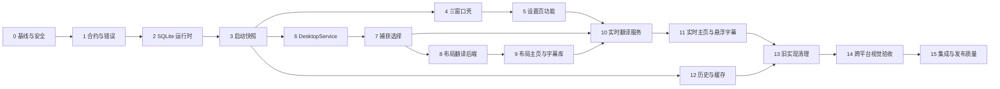

# LoreLingo 三界面产品实施计划

> **给执行代理：** 按任务逐项执行并维护复选框。若运行环境提供 `superpowers:executing-plans` 或 `superpowers:subagent-driven-development`，使用对应工作流逐任务实施；每个任务都必须先读本计划引用的设计和项目规范。

**目标：** 将现有主页与悬浮字幕原型、独立设置页原型、第一版 SQLite 设计和两项进行中的 OpenSpec 能力，收口为可生产使用的主页、悬浮字幕、设置页三个独立 Tauri 界面。

**架构：** 三个 Vue 入口只通过 `src/services/` 中的类型化客户端调用 Tauri。Rust 使用 `commands → services → domain/repositories/platform adapters` 分层；SQLite 是持久化权威来源，Rust 运行时服务是活动会话权威来源，Tauri 事件只做变化通知。

**技术栈：** Vue 3、TypeScript、Vite、Naive UI、Lucide Vue、Tauri 2、Rust、SQLite、macOS Keychain、Windows Credential Manager、macOS/Windows 原生捕获与 OCR 适配器。

**设计规格：** `docs/superpowers/specs/2026-08-05-three-window-product-design.md`

---

## 1. 执行约束

- 所有用户界面和仓库文档使用简体中文。
- 产品术语统一使用“悬浮字幕”；代码和事件使用 `Subtitle` / `subtitle`。
- 数据库翻译表前缀只使用 `tr_`；Rust/TypeScript 领域名称使用完整的 `translation`，动作使用 `translate`，不引入 `trans` 缩写。
- 不得修改已采用的 `0001_initial.sql`；后续模式变化只能新增 `0002_*.sql`。
- 只有 Rust 能打开 SQLite。Vue 不出现 SQL、表名、原生句柄和平台框架类型。
- API Key 只写入系统凭据存储；SQLite 只保存 `secret_ref`。
- 所有捕获、OCR、翻译和索引任务都必须有所有者、取消路径、终止状态和清理路径。
- 不得把模拟计时器、硬编码窗口、示例译文或浏览器预览描述为生产功能完成。
- 保留工作区已有的 `src-tauri/Cargo.lock` 改动，除非能证明它属于本计划所需依赖变化。
- 每次提交前按仓库 `AGENTS.md` 重新检查 `origin`、`user.name`、`user.email`；不得为身份修正改写历史。

### 每个源代码任务的最低检查

```bash
pnpm build
cargo fmt --check --manifest-path src-tauri/Cargo.toml
cargo check --manifest-path src-tauri/Cargo.toml
```

新增对应测试基础设施后，还需运行存在的 `pnpm lint`、`pnpm test`、`cargo test` 和 `cargo clippy`。没有脚本时记录为缺口，不得声称已运行。

---

## 2. 需求追踪

| 需求组 | 计划任务 |
| --- | --- |
| `MAIN-01`～`MAIN-03` 窗口导航、场景、来源 | 4、6、7 |
| `MAIN-04`～`MAIN-05` 实时控制与当前结果 | 10、11 |
| `MAIN-06` 保留布局翻译 | 8、9 |
| `MAIN-07` 历史记录 | 12 |
| `SUBTITLE-01`～`SUBTITLE-04` | 4、11 |
| `SETTINGS-01` 设置窗口 | 4 |
| `SETTINGS-02`～`SETTINGS-05` | 5 |
| `SETTINGS-06` 字幕库 | 9 |
| 数据库、凭据、启动快照 | 2、3、5 |
| 跨平台、可访问与发布质量 | 13、14、15 |

---

## 3. 任务依赖



---

## Task 0：校准基线并清理安全问题

**覆盖：** 所有后续任务的安全与事实基线。

**主要文件：**

- 修改：`src/components/settings/TranslatePanel.vue`
- 修改：`prototype/settings.html`
- 修改：`openspec/changes/translate-captured-layout/tasks.md`
- 修改：`openspec/changes/support-windows-macos/tasks.md`
- 检查：`src-tauri/Cargo.lock`

- [x] 0.1 删除生产组件和原型中所有形似真实 API Key 的默认值，使用空值或明显占位文案。
- [x] 0.2 搜索源码、原型、测试和文档中的 `sk-`、授权头、固定令牌与凭据，确认无明文秘密。
- [x] 0.3 对照当前 Rust/Vue 实现，更新两项 OpenSpec 的已完成复选框；只勾选有真实代码和验证证据的任务。
- [x] 0.4 记录当前 `Cargo.lock` 改动来源；后续依赖更新只保留可由 `Cargo.toml` 重现的差异。
- [x] 0.5 运行当前基线构建和 Rust 检查，记录已存在失败，不把基线问题归因于后续任务。

**2026-08-05 执行记录：** `Cargo.toml` 新增并精确锁定 `rusqlite 0.39.0` 的 `bundled` 功能，锁文件新增项可由该依赖及其跨目标可选依赖重现；工作区原有的 `lore-lingo` 包块位置变化予以保留。基线 `pnpm build`、Rust 格式检查和当前 macOS 目标检查均通过，未发现需要归因给后续任务的既有失败。

**完成条件：** 仓库不存在明文或形似真实的默认密钥；OpenSpec 状态与源码一致；工作区既有改动边界清楚。

---

## Task 1：定义稳定 DTO、错误码和前端客户端边界

**覆盖：** 三个窗口共享的 IPC 合约。

**创建：**

- `src/types/app.ts`
- `src/types/settings.ts`
- `src/types/desktop.ts`
- `src/types/translation.ts`
- `src/types/subtitleLibrary.ts`
- `src/types/history.ts`
- `src/services/appClient.ts`
- `src/services/windowClient.ts`
- `src/services/settingsClient.ts`
- `src/services/modelClient.ts`
- `src/services/shortcutClient.ts`
- `src/services/desktopClient.ts`
- `src/services/captureClient.ts`
- `src/services/translationClient.ts`
- `src/services/subtitleLibraryClient.ts`
- `src/services/historyClient.ts`
- `src-tauri/src/domain/app.rs`
- `src-tauri/src/domain/settings.rs`
- `src-tauri/src/domain/translation.rs`
- `src-tauri/src/domain/history.rs`

**修改：**

- `src-tauri/src/domain/mod.rs`
- `src-tauri/src/commands/mod.rs`

- [x] 1.1 定义 `BootstrapSnapshot`、平台能力、窗口摘要、设置摘要、活动会话和最新结果 DTO。
- [ ] 1.2 为捕获来源使用稳定 `source_id`、`catalog_revision` 和平台中立元数据，废弃 Vue 中的 `WindowInfo.exe` 假设。
- [x] 1.3 定义实时会话状态 `idle | starting | running | paused | stopping | error`。
- [x] 1.4 定义布局任务状态 `idle | selecting | capturing | recognizing | translating | completed | cancelled | failed`。
- [x] 1.5 定义稳定公开错误结构：`code`、`message`、`recoverable`、可选 `action`；不得返回原生错误字符串。
- [ ] 1.6 在 `src/services/` 中建立唯一 `invoke` 与事件封装；组件和新 composable 不直接导入 Tauri API。
- [ ] 1.7 为 DTO 序列化、未知枚举和错误映射添加 Rust/TypeScript 测试。

**完成条件：** 后续任务可只依赖公开 DTO；Vue 合约中没有 SQL、表名、路径或句柄。

---

## Task 2：实现 SQLite 连接、migration runner 和仓储

**覆盖：** 第一版数据库真正进入应用运行时。

**创建：**

- `src-tauri/src/db/mod.rs`
- `src-tauri/src/db/connection.rs`
- `src-tauri/src/db/migrations.rs`
- `src-tauri/src/db/repositories/mod.rs`
- `src-tauri/src/db/repositories/app_preferences.rs`
- `src-tauri/src/db/repositories/model_profiles.rs`
- `src-tauri/src/db/repositories/translation_settings.rs`
- `src-tauri/src/db/repositories/ocr_settings.rs`
- `src-tauri/src/db/repositories/shortcut_bindings.rs`
- `src-tauri/src/db/repositories/window_states.rs`
- `src-tauri/src/db/repositories/capture_settings.rs`
- `src-tauri/src/db/repositories/subtitle_library.rs`
- `src-tauri/src/db/repositories/translation_sessions.rs`
- `src-tauri/src/db/repositories/translation_history.rs`
- `src-tauri/src/db/repositories/translation_cache.rs`
- `src-tauri/tests/migrations.rs`

**修改：**

- `src-tauri/Cargo.toml`
- `src-tauri/src/lib.rs`

- [x] 2.1 选择并锁定受维护的 Rust SQLite 驱动；确认目标构建包含 JSON1、FTS5 和 trigram tokenizer 所需能力。
- [x] 2.2 在应用数据目录创建数据库，所有连接启用外键、WAL 和有界 busy timeout。
- [x] 2.3 实现 migration runner：按文件名前缀顺序执行，成功后写入 `db_schema_migrations`，失败时回滚并拒绝继续启动业务服务。
- [x] 2.4 migration runner 校验版本、名称、重复版本、历史不一致和未知更高版本。
- [ ] 2.5 为第一版全部 `sys_`、`sub_`、`tr_` 表建立职责明确的仓储，不提供通用键值 SQL 命令。（当前已建立启动快照所需的读取、统计和应用偏好写入边界；模型、设置、字幕条目、会话、历史与缓存的完整读写将在 Task 5、9、10、12 补齐后勾选。）
- [x] 2.6 配置单例表缺失时在 migration 或启动事务中补齐默认行，不在 Vue 中补默认值。
- [x] 2.7 添加全新建库、重复启动恰好一次、迁移失败回滚、外键、JSON、枚举、FTS 触发器和快捷键冲突测试。
- [x] 2.8 检查字幕、历史和缓存热点查询计划，并只为已证明查询补充后续 migration。

**完成条件：** 空应用数据目录可自动建库；第二次启动不重复执行；仓储测试可读写所有第一版配置和业务数据。

---

## Task 3：实现应用组合和启动快照

**覆盖：** 三个窗口的一致初始状态。

**创建：**

- `src-tauri/src/services/bootstrap.rs`
- `src-tauri/src/commands/app.rs`
- `src/composables/useBootstrap.ts`

**修改：**

- `src-tauri/src/services/mod.rs`
- `src-tauri/src/commands/mod.rs`
- `src-tauri/src/lib.rs`
- `src/main.ts`
- `src/subtitle.ts`

- [ ] 3.1 在 `lib.rs` 组装数据库、仓储、平台适配器和服务，并通过 Tauri state 注入；不得继续把业务函数堆入 `lib.rs`。
- [x] 3.2 实现 `get_bootstrap_snapshot`，一次返回平台能力、设置、默认模型摘要、快捷键、捕获选择、活动会话和最新结果。
- [x] 3.3 为快照增加 `settings_revision`、`capture_revision`、`session_revision`，供事件丢失后的重新查询使用。
- [ ] 3.4 前端三个入口在渲染业务界面前处理 `loading | ready | database_error | unsupported` 启动状态。
- [ ] 3.5 删除新入口中的硬编码示例原文、译文、模型、窗口和 OCR 成功状态。
- [x] 3.6 添加快照组合测试：空数据库、有默认配置、模型被删除、活动会话不存在和数据库失败。

**完成条件：** 任意窗口单独显示时都能从 Rust 恢复一致状态，不依赖另一个窗口先发事件。

---

## Task 4：建立三窗口壳、独立设置入口和共享主题

**覆盖：** `MAIN-01`、`SUBTITLE-01`、`SETTINGS-01`。

**创建：**

- `settings.html`
- `src/settings.ts`
- `src/SettingsApp.vue`
- `src/components/settings/SettingsShell.vue`
- `src/components/AppProviders.vue`
- `src/composables/useWindowNavigation.ts`
- `src-tauri/src/commands/windows.rs`
- `src-tauri/src/services/window_service.rs`
- `src-tauri/capabilities/main.json`
- `src-tauri/capabilities/subtitle.json`
- `src-tauri/capabilities/settings.json`

**修改：**

- `vite.config.ts`
- `src-tauri/tauri.conf.json`
- `src-tauri/capabilities/default.json` 或将其拆分后删除
- `src/App.vue`
- `src/SubtitleApp.vue`
- `src/components/main-panel/TitleBar.vue`
- `package.json`
- `pnpm-lock.yaml`

- [ ] 4.1 将 `settings.html` 加入 Vite 多入口构建，挂载独立 `SettingsApp.vue`。
- [ ] 4.2 在 Tauri 配置中增加默认隐藏的 `settings` 窗口；以原型 520×680 为视觉基线并设置可用最小尺寸。
- [ ] 4.3 主页、悬浮字幕、设置页分别配置最小权限 capability；设置页不需要捕获或任意 shell 权限。
- [ ] 4.4 实现 `show_or_focus_window`、`hide_window`、窗口状态读取与保存；重复打开只聚焦已有窗口。
- [ ] 4.5 将主页 `SettingsDrawer` 改为打开独立设置页；保留抽屉组件仅作为迁移代码并在 Task 13 删除。
- [ ] 4.6 引入 Naive UI 和 Lucide Vue，建立三个根共用的 `AppProviders`、语义令牌和平台主题输入。
- [ ] 4.7 三个窗口分别恢复位置、尺寸和置顶状态；恢复时限制在当前可见工作区。
- [ ] 4.8 添加窗口导航、重复打开、关闭隐藏、状态恢复和 capability 最小权限测试。

**完成条件：** 构建产物包含三个 HTML 入口；三个原生窗口可相互显示/聚焦；设置不再以内嵌抽屉作为目标形态。

---

## Task 5：完成设置页四个模块和系统凭据

**覆盖：** `SETTINGS-02`～`SETTINGS-05`，字幕库壳在本任务建立，真实导入在 Task 9。

**创建：**

- `src/components/settings/TranslationSettingsPanel.vue`
- `src/components/settings/ModelProfilesPanel.vue`
- `src/components/settings/ShortcutBindingsPanel.vue`
- `src/components/settings/OcrSettingsPanel.vue`
- `src/components/settings/SubtitleLibraryPanel.vue`
- `src/composables/useSettingsForm.ts`
- `src-tauri/src/commands/settings.rs`
- `src-tauri/src/commands/models.rs`
- `src-tauri/src/commands/shortcuts.rs`
- `src-tauri/src/services/settings_service.rs`
- `src-tauri/src/services/model_service.rs`
- `src-tauri/src/services/shortcut_service.rs`
- `src-tauri/src/desktop/credentials.rs`
- `src-tauri/src/desktop/shortcuts.rs`

**修改：**

- `src/SettingsApp.vue`
- `src-tauri/Cargo.toml`
- `src-tauri/src/lib.rs`

- [ ] 5.1 建立“翻译、快捷键、OCR、字幕库”四个一级导航和键盘可访问的 tab/panel 关系。
- [ ] 5.2 翻译面板保存模式、自动间隔、语言、超时、字幕优先、历史开关和保留天数；提交前进行范围校验和秒/毫秒转换。
- [ ] 5.3 模型面板支持配置 CRUD、默认模型、启用状态、非敏感 options 和连接测试。
- [ ] 5.4 使用 macOS Keychain / Windows Credential Manager 保存模型与云 OCR 凭据；数据库只更新 `secret_ref` 和“是否已配置”摘要。
- [ ] 5.5 连接测试实施超时、响应大小限制、URL 协议与 SSRF 策略；公开结果不回显请求头和密钥。
- [ ] 5.6 快捷键面板监听真实键盘/手柄输入，规范化 `binding_key`，显示冲突动作，支持清除和恢复默认。
- [ ] 5.7 保存快捷键后原子地刷新全局注册；注册失败返回“已保存但未生效”，不得假装成功。
- [ ] 5.8 OCR 面板根据平台能力展示引擎可用性，保存语言数组、采样帧率、置信度、去重和专属参数。
- [ ] 5.9 设置保存成功后递增修订号并发出 `settings:changed`；其他窗口按需重新读取。
- [ ] 5.10 添加表单校验、凭据不落库、快捷键冲突、注册失败恢复和设置重启持久化测试。

**完成条件：** 四个设置模块均由真实 Rust 服务支持；重启后配置存在；数据库、日志和前端状态中没有 API Key 本体。

---

## Task 6：建立跨平台 DesktopService

**覆盖：** `MAIN-03`、跨平台能力和权限。

**创建/调整目标：**

- `src-tauri/src/desktop/platform/mod.rs`
- `src-tauri/src/desktop/platform/windows.rs`
- `src-tauri/src/desktop/platform/macos.rs`
- `src-tauri/src/desktop/capture.rs`
- `src-tauri/src/commands/desktop.rs`
- `src-tauri/src/services/capture_service.rs`

**迁移来源：**

- `src-tauri/src/lib.rs` 中的 `list_windows`、`list_screens`、Win32 图标提取
- `openspec/changes/support-windows-macos/`

- [ ] 6.1 定义 `DesktopService` / `PlatformBackend` 接口：平台能力、权限、显示器目录、窗口目录、来源修订号和捕获会话。
- [ ] 6.2 Windows 与 macOS 适配器返回同一 `CaptureSource` DTO；平台独有字段留在适配器内部。
- [ ] 6.3 实现权限预检、请求、拒绝、需要设置/重启和能力不可用状态。
- [ ] 6.4 过滤 LoreLingo 自身窗口；无法排除时返回准确能力状态。
- [ ] 6.5 为来源目录建立稳定排序、修订号和过期选择错误。
- [ ] 6.6 添加目录、权限、来源关闭、受保护内容、显示器/DPI 坐标转换和错误映射测试。

**完成条件：** 新前端不再调用 legacy `list_windows`、`list_screens`；同一来源选择界面可消费 Windows/macOS 合约。

---

## Task 7：完成主页来源选择与临时框选窗口

**覆盖：** `MAIN-02`、`MAIN-03`。

**创建/修改：**

- `src/components/main-panel/TranslationSceneSwitch.vue`
- `src/components/main-panel/CaptureSourcePicker.vue`
- `src/composables/useCaptureSelection.ts`
- `src-tauri/src/commands/capture.rs`
- `src-tauri/src/services/capture_service.rs`
- `src-tauri/capabilities/capture-selector.json`
- `src/components/main-panel/SourceRow.vue`
- `src/components/main-panel/CaptureTarget.vue`

- [ ] 7.1 在主页增加“实时悬浮字幕 / 保留布局翻译”场景切换，并处理活动会话切换确认。
- [ ] 7.2 来源选择器展示加载、空目录、权限拒绝、不可用、过期和刷新状态。
- [ ] 7.3 应用来源选择保存稳定选择器到 `sys_capture_settings.app_selector_json`，不保存 HWND。
- [ ] 7.4 区域选择为每个显示器创建临时 `capture-selector-*` 窗口，返回显示器本地逻辑坐标。
- [ ] 7.5 完成、取消、Escape、显示器断开和错误时销毁所有选择器窗口与事件监听。
- [ ] 7.6 删除 `useCaptureSource.ts` 中的模拟定时器和硬编码区域元数据。
- [ ] 7.7 添加键盘路径、多显示器、DPI、取消、过期来源和监听清理测试。

**完成条件：** 主页能选择真实来源；区域框选不再模拟；切换场景不会留下选择器或捕获线程。

---

## Task 8：收口保留布局翻译后端

**覆盖：** `MAIN-06` 后端。

**主要文件：**

- 修改：`src-tauri/src/commands/capture_translation.rs`
- 修改：`src-tauri/src/services/capture_translation.rs`
- 修改：`src-tauri/src/services/translation.rs`
- 修改：`src-tauri/src/domain/captured_layout.rs`
- 修改：`src-tauri/src/desktop/ocr/macos.rs`
- 创建：Windows OCR/平台实现或明确的不支持适配器

- [ ] 8.1 将现有捕获翻译命令对齐 Task 1 的统一布局任务 DTO 和公开错误。
- [ ] 8.2 每次新任务替换并取消旧任务；完成、失败和取消后释放显示器截图、选择器和任务状态。
- [ ] 8.3 只接受与当前任务、显示器目录修订号和合法逻辑矩形匹配的完成请求。
- [ ] 8.4 OCR 返回归一化文本块边界；过滤空文本并限制块数量和总字符数。
- [ ] 8.5 批量翻译结果按块标识匹配，允许局部缺失，不把译文错配到其他块。
- [ ] 8.6 布局截图只存在任务结果内，不写入第一版 SQLite；关闭或替换任务后释放。
- [ ] 8.7 添加坐标转换、旧任务、无文本、局部翻译、响应过大、取消和平台不支持测试。

**完成条件：** 后端可稳定完成一次真实布局翻译，并且所有失败路径返回可恢复的结构化状态。

---

## Task 9：实现主页布局工作区和字幕库

**覆盖：** `MAIN-06` 前端、`SETTINGS-06`。

**创建：**

- `src/components/main-panel/LayoutTranslationWorkspace.vue`
- `src/composables/useLayoutTranslation.ts`
- `src-tauri/src/commands/subtitle_library.rs`
- `src-tauri/src/services/subtitle_library.rs`
- `src-tauri/src/services/subtitle_matcher.rs`

**修改：**

- `src/components/main-panel/MainPanel.vue`
- `src/components/settings/SubtitleLibraryPanel.vue`
- `src-tauri/src/db/repositories/subtitle_library.rs`

- [ ] 9.1 主页布局工作区渲染截图、原文块、译文块和任务状态；坐标换算放在有测试的纯函数中。
- [ ] 9.2 支持重新框选、取消、重试翻译、复制全部译文和返回实时场景。
- [ ] 9.3 处理无文本、部分块失败、任务过期和整体验证失败，不显示模拟成功。
- [ ] 9.4 字幕库使用受限文件选择器导入 `.srt`、`.ass`、`.vtt`，校验大小、格式和编码。
- [ ] 9.5 后台解析文件并维护 `pending → indexing → ready | failed` 状态、条目数和错误摘要。
- [ ] 9.6 删除字幕文件时在事务中级联条目，并验证 FTS 外部内容触发器一致。
- [ ] 9.7 实现字幕匹配接口，输入规范化文本与语言，输出匹配条目、置信度和文件摘要。
- [ ] 9.8 添加三种格式解析、恶意/超大输入、索引失败重试、删除、FTS 和组件状态测试。

**完成条件：** 用户可在主页完成布局翻译；设置页可真实导入、查看、重试和删除字幕文件。

---

## Task 10：实现实时翻译会话、字幕匹配和缓存链路

**覆盖：** `MAIN-04`、`MAIN-05` 后端。

**创建：**

- `src-tauri/src/services/live_translation.rs`
- `src-tauri/src/services/ocr_service.rs`
- `src-tauri/src/services/history_service.rs`
- `src-tauri/src/commands/translation.rs`

**修改：**

- `src-tauri/src/services/translation.rs`
- `src-tauri/src/db/repositories/translation_sessions.rs`
- `src-tauri/src/db/repositories/translation_cache.rs`
- `src-tauri/src/db/repositories/translation_history.rs`

- [ ] 10.1 建立单一活动实时会话，支持手动任务和自动会话的开始、暂停、继续、停止与替换。
- [ ] 10.2 捕获管线使用容量 1 最新帧；慢 OCR/网络请求不会持有全局锁或形成无界队列。
- [ ] 10.3 实现帧去重、OCR 文本规范化和重复结果抑制。
- [ ] 10.4 按 `字幕库 → tr_cache → 模型` 顺序解析，结果标记 `subtitle | cache | model | none`。
- [ ] 10.5 缓存键包含规范化原文、语言、模型和影响译文的配置哈希；命中时更新访问时间与次数。
- [ ] 10.6 按 `save_history` 写入 `tr_history`，成功和失败状态满足表约束；历史写入失败不得破坏已完成结果展示。
- [ ] 10.7 停止或替换后丢弃迟到 OCR/模型响应；停止完成前状态保持 `stopping`。
- [ ] 10.8 发出带会话修订号的状态/结果通知，并提供查询当前快照命令。
- [ ] 10.9 添加背压、取消、迟到响应、字幕命中、缓存命中、模型失败、历史失败和会话替换测试。

**完成条件：** Rust 服务可独立运行完整实时链路，且停止后无后台帧和迟到结果更新。

---

## Task 11：完成主页实时工作区和悬浮字幕

**覆盖：** `MAIN-04`、`MAIN-05`、`SUBTITLE-01`～`SUBTITLE-04`。

**创建/修改：**

- `src/components/main-panel/LiveTranslationWorkspace.vue`
- `src/composables/useLiveTranslation.ts`
- `src/composables/useSubtitleSession.ts`
- `src/components/main-panel/MainPanel.vue`
- `src/components/main-panel/Toolbar.vue`
- `src/components/main-panel/TranslationCard.vue`
- `src/components/subtitle/SubtitleBar.vue`
- `src/components/subtitle/SubtitleControls.vue`
- `src/components/subtitle/SubtitleContent.vue`
- `src/composables/useSubtitleWindow.ts`
- `src/services/subtitleWindow.ts`

- [ ] 11.1 主页按钮和快捷键调用同一实时会话客户端，渲染完整状态机而不是独立布尔值。
- [ ] 11.2 当前结果显示原文、译文、来源、捕获目标、复制操作和加载/暂停/错误状态。
- [ ] 11.3 悬浮字幕首次打开主动查询会话快照；收到事件时按修订号更新或重新查询。
- [ ] 11.4 悬浮字幕只显示实时会话，不显示布局翻译文档。
- [ ] 11.5 重选捕获从悬浮字幕聚焦主页并进入选择流程；关闭字幕只隐藏窗口，不停止会话。
- [ ] 11.6 将悬浮字幕宽度、位置、显示器锚点和置顶从 `localStorage` 迁移到 `sys_window_states`。
- [ ] 11.7 内容高度变化时节流调整原生窗口；短文本、长文本、换行和错误状态不得截断。
- [ ] 11.8 控制条支持鼠标、键盘聚焦和外部 peek；所有图标按钮具有工具提示与无障碍名称。
- [ ] 11.9 移除 `useTranslator.ts`、`useSubtitleBridge.ts` 中以示例状态和前端广播充当权威来源的逻辑。
- [ ] 11.10 添加会话状态、修订号、事件丢失恢复、隐藏不停止、窗口尺寸和键盘交互测试。

**完成条件：** 主页与悬浮字幕显示同一 Rust 会话；任一窗口晚打开或重载都能恢复正确状态。

---

## Task 12：完成主页历史视图和数据生命周期

**覆盖：** `MAIN-07`。

**创建：**

- `src/components/main-panel/HistoryView.vue`
- `src/composables/useHistory.ts`
- `src-tauri/src/commands/history.rs`

**修改：**

- `src/components/main-panel/TitleBar.vue`
- `src-tauri/src/services/history_service.rs`
- `src-tauri/src/db/repositories/translation_history.rs`
- `src-tauri/src/db/repositories/translation_cache.rs`

- [ ] 12.1 历史作为主页二级视图/抽屉打开，保留活动实时会话与当前结果。
- [ ] 12.2 实现 FTS 搜索、短于三字符的受限回退、语言/来源/模型/状态/收藏筛选和稳定游标分页。
- [ ] 12.3 支持复制、收藏、取消收藏、删除单条和清理非收藏历史。
- [ ] 12.4 按 `history_retention_days` 清理非收藏历史；收藏记录不自动删除。
- [ ] 12.5 缓存使用独立的到期/LRU 清理任务；历史清理不触碰 `tr_cache`，缓存清理不触碰 `tr_history`。
- [ ] 12.6 删除或禁用模型配置后，历史仍可读；界面显示保存的模型摘要或“配置已删除”。
- [ ] 12.7 添加搜索、分页稳定性、收藏保留、历史/缓存隔离和失败恢复测试。

**完成条件：** 历史功能完整且不会形成第四个原生窗口；数据保留策略符合第一版数据库设计。

---

## Task 13：删除旧实现并收口目录

**覆盖：** 防止两套架构长期并存。

**删除候选：**

- `src/components/settings/SettingsDrawer.vue`
- 被新设置面板替代的旧 `TranslatePanel.vue`、`OcrPanel.vue`、`SubsPanel.vue`
- 被新状态服务替代的 `useSettings.ts`、旧 `useTranslator.ts`、旧 `useSubtitleBridge.ts`
- legacy `list_windows`、`list_screens`、`capture_region`

- [ ] 13.1 使用 `rg` 证明所有生产调用已迁移后再删除旧组件、composable 和命令。
- [ ] 13.2 将 `lib.rs` 收口为应用组合、插件初始化、窗口生命周期和命令注册。
- [ ] 13.3 确认所有直接 `invoke`、Tauri 窗口与事件调用只存在于 `src/services/` 或根入口初始化边界。
- [ ] 13.4 确认生产入口不导入 `prototype/`，原型仅用于视觉对照。
- [ ] 13.5 更新 OpenSpec 任务状态和长期架构文档，删除与三窗口设计冲突的旧说明。
- [ ] 13.6 运行死代码、未使用依赖和锁文件差异检查。

**完成条件：** 仓库只剩一套设置、捕获、翻译和跨窗口状态架构。

---

## Task 14：跨平台视觉、主题和可访问验收

**覆盖：** 三个界面的生产视觉和原生窗口行为。

**主要文件：**

- `src/styles/global.css`
- 新增按平台组织的语义主题模块
- 三个根组件与所有交互组件
- macOS/Windows 窗口平台适配器

- [ ] 14.1 以三份原型为信息结构基线，用 Naive UI + Lucide 实现生产组件，不复制原型 JavaScript 状态桥。
- [ ] 14.2 macOS 与 Windows 使用同一业务组件，通过运行时能力映射 Liquid Glass/活力材质或 Mica/Acrylic。
- [ ] 14.3 为减少透明度、增加对比度、减少动画和材质失败提供不透明降级。
- [ ] 14.4 主页验证默认尺寸、最小尺寸、加载、空、权限拒绝、运行、暂停、失败、历史和布局结果。
- [ ] 14.5 设置页验证四个导航、表单错误、凭据状态、快捷键监听、字幕索引和长文本溢出。
- [ ] 14.6 悬浮字幕验证短/长文本、换行、控制条展开、拖动、调宽、显示器恢复和透明输入边界。
- [ ] 14.7 完成 Tab、方向键、Enter、Space、Escape、焦点恢复、实时区域和无障碍名称检查。
- [ ] 14.8 分别在 macOS WKWebView 与 Windows WebView2 截图和原生烟雾测试；浏览器预览只作为辅助证据。

**完成条件：** 三个界面在目标平台和辅助功能状态下可读、可操作、无重叠，原生材质失败时仍可用。

---

## Task 15：集成测试、CI 和发布质量

**覆盖：** 第一版整体完成条件。

- [ ] 15.1 建立前端单元/组件测试脚本，覆盖状态机、设置表单、来源选择、历史和跨窗口恢复。
- [ ] 15.2 建立 Rust 测试，覆盖 migration、仓储、会话背压、取消、错误映射、字幕解析和缓存策略。
- [ ] 15.3 建立三窗口原生烟雾测试清单：首次启动、权限拒绝/恢复、设置重启持久化、捕获、布局翻译、实时字幕、历史。
- [ ] 15.4 在 macOS 与 Windows 原生 CI 运行 pnpm 检查、Rust fmt/clippy/test 和未签名 Tauri 构建。
- [ ] 15.5 验证 Windows 100%/125%/150%/175%/200% DPI，macOS Retina/外接显示器，以及显示器断开恢复。
- [ ] 15.6 验证 SQLite 全新建库、从上一版本升级、应用异常退出后重启和 migration 失败保护。
- [ ] 15.7 验证数据库、日志、诊断、截图和构建产物中没有凭据或不必要的捕获文本。
- [ ] 15.8 更新 README/发布说明，准确区分已验证平台、未支持能力和降级行为。

**完成条件：** 设计规格第 13 节全部验收标准有可重复证据；未完成项以明确限制记录，不以模拟或静态检查代替端到端结论。

---

## 4. 推荐落地批次

### 批次 A：安全与持久化底座

```text
Task 0 → Task 1 → Task 2 → Task 3
```

交付结果：无密钥风险、SQLite 可运行、三窗口可获得一致启动快照。

### 批次 B：三窗口与设置持久化

```text
Task 4 → Task 5
```

交付结果：独立设置窗口可用，模型/翻译/OCR/快捷键真实保存。

### 批次 C：真实捕获与布局翻译

```text
Task 6 → Task 7 → Task 8 → Task 9
```

交付结果：主页可选择真实来源、完成一次布局翻译并管理字幕库。

### 批次 D：实时悬浮字幕与历史

```text
Task 10 → Task 11 → Task 12
```

交付结果：实时链路、悬浮字幕和历史形成完整用户闭环。

### 批次 E：收口与发布质量

```text
Task 13 → Task 14 → Task 15
```

交付结果：删除临时架构，完成双平台视觉、原生和发布验证。

---

## 5. 第一阶段建议执行范围

若没有额外范围指示，首次实施只执行 **Task 0～Task 3**：

1. 清理密钥风险并校准事实基线；
2. 建立稳定 DTO、错误和客户端边界；
3. 接入 SQLite、migration runner 和第一批仓储；
4. 返回真实 `BootstrapSnapshot`。

该范围不会提前重做视觉界面，但会为主页、悬浮字幕和设置页提供同一个可靠状态与持久化底座，后续任务无需再次推翻数据流。
