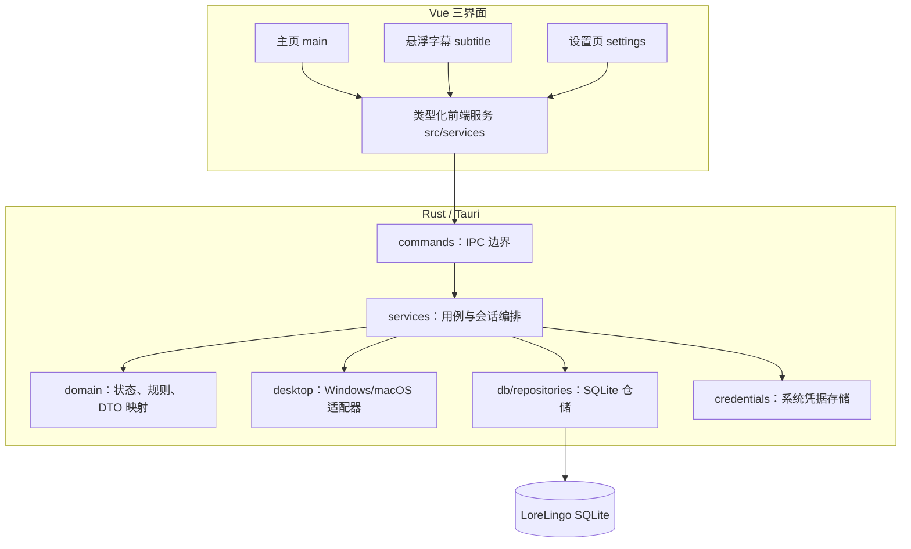
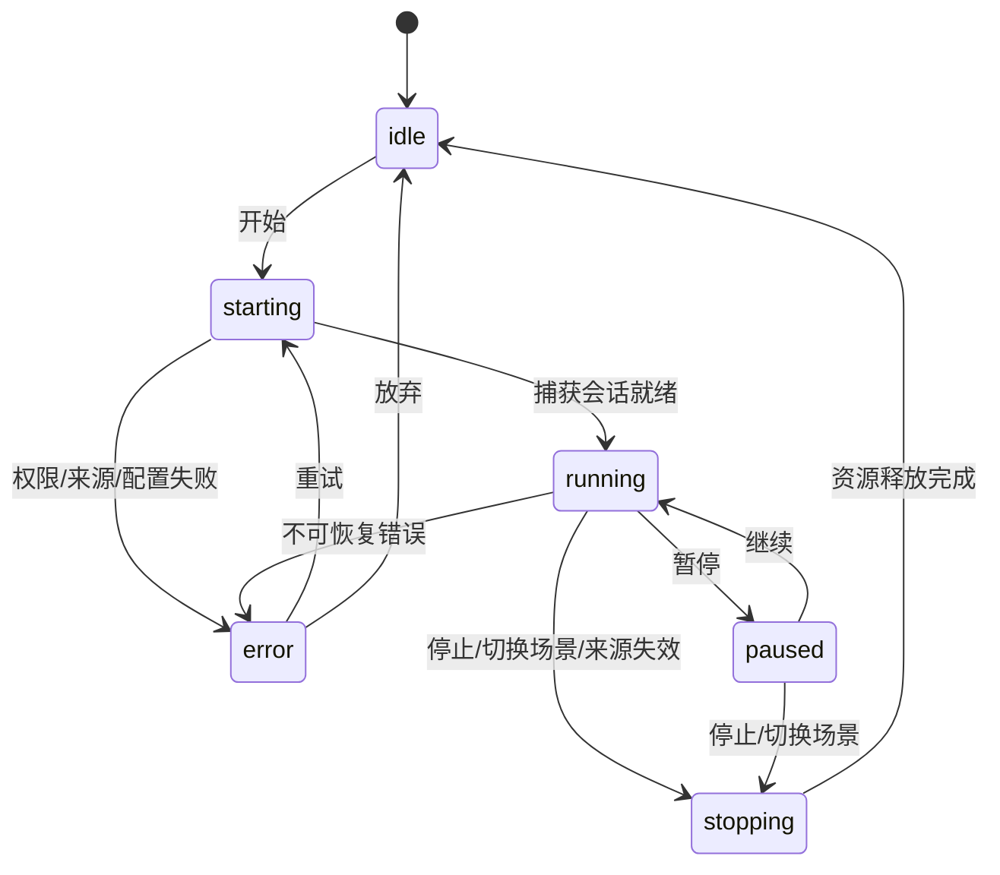
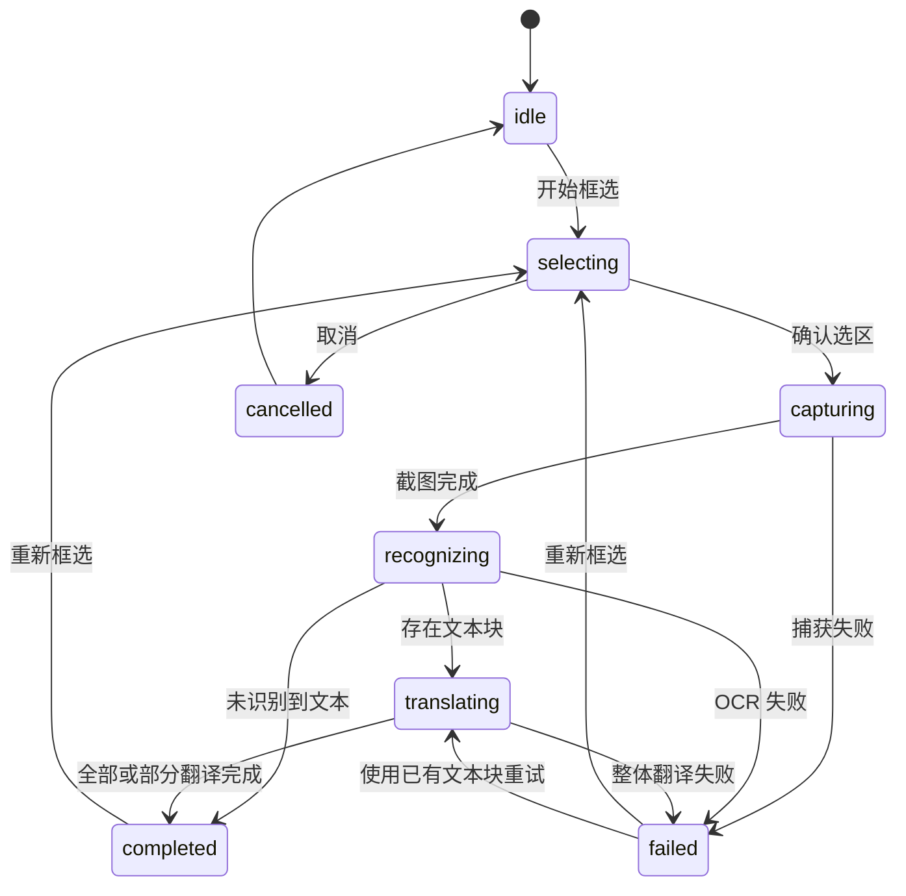

# LoreLingo 三界面产品与架构设计

**日期：** 2026-08-05
**状态：** 实施基线
**范围：** 主页、悬浮字幕、设置页，以及支撑三者的捕获、OCR、翻译、字幕库、历史和本地配置能力

---

## 1. 目标

LoreLingo 第一版桌面端固定由三个用户界面组成：

1. **主页**：选择捕获来源，发起实时翻译或保留布局翻译，查看当前结果和历史记录。
2. **悬浮字幕**：在其他应用上方持续展示实时识别与翻译结果，并提供最少量的高频控制。
3. **设置页**：管理翻译模型、翻译行为、快捷键、OCR 和字幕库。

三个界面是三个独立的 Tauri WebView 窗口，但共享同一个 Rust 应用服务、SQLite 数据库和运行时会话。Vue 不直接读写 SQLite，不保存明文密钥，也不把跨窗口事件当作权威数据源。

本设计同时约束：

- `prototype/index.html`、`prototype/subtitle.html`、`prototype/settings.html` 的产品结构如何进入生产代码；
- `docs/database-design.md` 与 `src-tauri/migrations/0001_initial.sql` 中第一版数据表由哪个界面和后端模块使用；
- `translate-captured-layout` 与 `support-windows-macos` 两项 OpenSpec 变更如何落到三个界面；
- 前端、Tauri 命令、用例服务、平台适配器和仓储的职责边界。

---

## 2. 关键产品决策

### 2.1 只有三个常驻产品界面

| 界面 | Tauri 标签 | 前端入口 | 启动行为 | 主要职责 |
| --- | --- | --- | --- | --- |
| 主页 | `main` | `index.html` → `src/main.ts` → `App.vue` | 应用启动时显示 | 捕获、翻译、结果、历史、窗口导航 |
| 悬浮字幕 | `subtitle` | `subtitle.html` → `src/subtitle.ts` → `SubtitleApp.vue` | 默认隐藏，需要时显示 | 实时结果展示与高频控制 |
| 设置页 | `settings` | `settings.html` → `src/settings.ts` → `SettingsApp.vue` | 默认隐藏，需要时显示 | 模型、翻译、快捷键、OCR、字幕库设置 |

以下窗口属于临时工作窗口，不算新的产品界面：

- `capture-selector-*`：每个显示器一个临时框选窗口；完成、取消或失败后必须销毁。
- 原生文件选择器、确认对话框和系统权限面板：由用例临时打开，不承载独立业务状态。

历史记录属于主页的二级视图或抽屉，不创建第四个原生窗口。

### 2.2 两条翻译工作流必须分开

主页承载两条共享底座但状态机不同的工作流：

#### 实时悬浮字幕

```text
选择应用或区域
  → 启动持续捕获
  → 最新帧 OCR
  → 字幕库匹配
  → 翻译缓存
  → 模型翻译
  → 更新主页当前结果
  → 更新悬浮字幕
  → 按策略写入历史
```

#### 保留布局翻译

```text
选择“保留布局翻译”
  → 单次框选区域
  → 对选区截图执行 OCR
  → 得到带坐标的文本块
  → 批量翻译
  → 在主页布局工作区按原位置展示
  → 用户复制结果或重新框选
  → 按策略写入历史
```

实时流程采用“最新帧优先”和可取消会话；布局流程采用“一次任务一个结果文档”。不得用同一组布尔值同时表达两条流程。

### 2.3 数据和状态的权威来源

| 数据类型 | 权威来源 | 说明 |
| --- | --- | --- |
| 模型、翻译、OCR、快捷键、捕获和窗口设置 | SQLite + 系统凭据存储 | 由 Rust 仓储和凭据适配器访问 |
| 当前捕获会话、正在运行的 OCR/翻译任务 | Rust 运行时服务 | 不写入 SQLite |
| 当前翻译结果和会话状态 | Rust 翻译会话服务 | 通过查询命令读取，通过事件通知变化 |
| 历史、字幕库、缓存 | SQLite | 历史和缓存具有独立生命周期 |
| 窗口局部交互状态 | 当前 Vue 窗口 | 例如下拉框是否展开、当前输入焦点 |
| 跨窗口事件 | 通知通道 | 只提示“数据已变化”，接收方必要时重新查询权威快照 |

应用启动时由 Rust 返回一次 `BootstrapSnapshot`，三个窗口不得各自使用硬编码示例或 `localStorage` 组装不同的初始状态。

---

## 3. 总体架构



固定分层为：

```text
Tauri commands
  → services / use cases
  → domain / repositories / platform adapters
```

命令层只做输入校验、DTO 转换、调用单个用例和公开错误映射。SQL 只能存在于 `src-tauri/src/db/`，原生句柄和平台框架类型只能存在于 `src-tauri/src/desktop/`。

---

## 4. 主页设计

### 4.1 信息架构

主页沿用原型的紧凑主面板结构，并补齐布局翻译与历史入口：

```text
原生/自定义标题栏
  ├─ LoreLingo、运行状态
  ├─ 打开悬浮字幕
  ├─ 主页置顶
  ├─ 历史记录
  └─ 打开设置

翻译场景
  ├─ 实时悬浮字幕
  └─ 保留布局翻译

捕获来源
  ├─ 捕获应用
  └─ 框选区域

捕获目标
  ├─ 当前应用/区域摘要
  ├─ 来源目录与刷新
  └─ 重选

翻译方向
  ├─ 源语言
  ├─ 切换方向
  └─ 目标语言

工作区
  ├─ 实时：当前原文、译文、结果来源、复制
  └─ 布局：截图背景、文本块、译文块、缩放与重新框选

操作区
  ├─ 手动翻译
  ├─ 开始/暂停/继续/停止自动翻译
  └─ 打开悬浮字幕

二级视图
  └─ 历史列表、搜索、筛选、收藏、复制、删除
```

### 4.2 主页功能需求

#### MAIN-01 窗口导航

- 标题栏可打开或聚焦悬浮字幕和设置页，不重复创建同标签窗口。
- 支持主页置顶，状态由 Rust 窗口服务设置并写入 `sys_window_states`。
- 设置页或悬浮字幕可反向聚焦主页。
- 窗口关闭、隐藏和应用退出必须区分；关闭设置页与悬浮字幕默认只隐藏，退出应用由主页或托盘策略统一处理。

#### MAIN-02 翻译场景选择

- 默认场景为“实时悬浮字幕”。
- 切换到“保留布局翻译”时，必须停止或明确暂停正在运行的实时会话。
- 场景切换不得复用旧任务结果；过期响应必须按任务标识丢弃。
- 场景选择属于运行时界面状态，第一版不要求持久化。

#### MAIN-03 捕获来源选择

- “捕获应用”展示当前可捕获窗口目录，包含稳定来源标识、标题、应用名、图标和可用状态。
- “框选区域”通过每显示器临时选择器获得显示器本地逻辑坐标；取消后保留上一次有效配置。
- 来源目录包含修订号，选中来源过期或窗口关闭时显示可恢复错误并要求刷新或重选。
- 不向 Vue 暴露 `HWND`、Core Graphics 对象、原始可执行路径或平台框架类型。
- 选择结果保存到 `sys_capture_settings`；应用选择器保存稳定字段，不保存瞬时句柄。

#### MAIN-04 实时翻译控制

- 手动模式每次只执行一个捕获—OCR—匹配—翻译任务。
- 自动模式支持开始、暂停、继续和停止；停止必须取消捕获和下游任务。
- 自动捕获使用容量为 1 的最新帧语义，禁止无界帧队列。
- 快捷键和手柄动作与界面按钮调用同一个用例，不复制业务逻辑。
- 未配置模型时，如果字幕库不能命中，应返回 `translation_not_configured`，并提供打开设置页的恢复入口。

实时会话状态：



#### MAIN-05 当前翻译结果

- 同时显示原文和译文，并明确标注结果来源：`subtitle`、`cache`、`model` 或 `none`。
- 支持复制原文、复制译文、切换语言方向。
- 加载、无文本、字幕命中、缓存命中、模型翻译、失败和已暂停必须有不同的语义状态。
- 新结果只能覆盖同一活动会话中更旧的结果；停止后的迟到响应不得刷新界面。
- 结果文本按纯文本渲染，不执行模型或字幕文件中的 HTML。

#### MAIN-06 保留布局翻译

- 进入场景后发起单次框选，展示等待框选、截图中、OCR 中、翻译中、完成、失败和已取消状态。
- 完成结果包含截图尺寸、截图预览、源语言、目标语言和多个带归一化边界框的文本块。
- 每个文本块显示原文和译文；翻译失败的块保留原文并显示局部错误。
- 支持重新框选、重试翻译、复制全部译文和退出布局视图。
- 选择器窗口销毁后才能开始实际捕获，避免 LoreLingo 自身进入截图。

布局任务状态：



#### MAIN-07 历史记录

- 历史作为主页二级视图打开，不影响活动翻译会话。
- 支持按原文/译文全文搜索，按语言、结果来源、模型、状态、收藏筛选。
- 列表按 `created_at DESC, id DESC` 稳定分页。
- 支持收藏/取消收藏、复制、删除单条和清理非收藏历史。
- 错误历史必须显示用户可理解的公开错误码/消息，不显示原生堆栈、路径或请求头。
- `save_history=0` 时不新增 `tr_history`，但缓存策略不受影响。

### 4.3 主页边界

- 主页不编辑完整模型配置，只显示当前模型摘要和“去设置”入口。
- 主页不展示数据库表名、迁移版本或缓存键。
- 主页关闭下拉框、抽屉或二级视图时，不得取消无关的后台会话。

---

## 5. 悬浮字幕设计

### 5.1 信息架构

悬浮字幕保持原型中的两层结构：

```text
悬浮控制条（鼠标进入、键盘聚焦或外部唤醒时显示）
  ├─ 当前捕获目标与运行状态
  ├─ 重选捕获
  ├─ 切换翻译方向
  ├─ 置顶
  ├─ 复制译文
  ├─ 打开主页
  └─ 关闭悬浮字幕

字幕内容区
  ├─ 结果来源标签
  ├─ 原文
  ├─ 译文
  └─ 暂停、无文本或错误状态
```

### 5.2 悬浮字幕功能需求

#### SUBTITLE-01 窗口行为

- 默认置顶、默认隐藏、按内容调整原生窗口高度。
- 支持拖动和左右调整宽度；位置、尺寸、置顶和显示器锚点写入 `sys_window_states`。
- 显示器断开、缩放变化或工作区变化时，窗口必须被约束回可见工作区。
- 透明区域不能形成覆盖整个桌面的输入表面。
- 捕获能力支持时排除 LoreLingo 自身窗口；不支持时返回明确能力状态。

#### SUBTITLE-02 实时内容

- 只消费当前活动实时会话，不显示布局翻译文档。
- 初次显示时主动查询当前会话快照；事件只负责通知有新结果。
- 显示原文、译文、捕获目标、会话状态和结果来源。
- 没有活动会话时显示“尚未开始翻译”，并提供打开主页入口。
- 会话暂停时保留最后结果并标记“已暂停”；停止后可保留最后结果，但不得显示为仍在实时运行。

#### SUBTITLE-03 高频控制

- 重选捕获：聚焦主页并进入来源选择，不在悬浮字幕内实现来源目录。
- 切换方向：调用翻译设置用例；活动会话按定义重启或在下一次任务生效。
- 置顶：只改变悬浮字幕窗口，不联动主页置顶。
- 复制：复制当前译文，无译文时禁用。
- 打开主页：显示并聚焦 `main`。
- 关闭：隐藏 `subtitle`，默认不停止活动会话；停止会话必须使用明确的停止操作或快捷键。

#### SUBTITLE-04 可访问与降级

- 控制条不能只依赖鼠标悬停；键盘聚焦、外部 peek 事件也能显示。
- 所有图标按钮具有中文工具提示、无障碍名称和可见焦点。
- macOS 透明材质不可用、Windows Mica/Acrylic 不可用或系统要求减少透明度时，使用可读的不透明/半透明表面。

---

## 6. 设置页设计

### 6.1 导航结构

设置页沿用原型的四个一级导航：

| 一级模块 | 子模块 | 主要数据 |
| --- | --- | --- |
| 翻译 | 翻译行为、语言、历史策略、模型配置 | `sys_translation_settings`、`sys_model_profiles`、系统凭据存储 |
| 快捷键 | 键盘绑定、手柄绑定、冲突与恢复默认 | `sys_shortcut_bindings` |
| OCR | OCR 引擎、语言、采样、阈值、引擎参数 | `sys_ocr_settings` |
| 字幕库 | 导入、索引状态、重试、移除 | `sub_files`、`sub_entries`、`sub_entries_fts` |

`sys_window_states` 由窗口服务自动维护；`sys_capture_settings` 主要由主页来源选择维护；`sys_app_preferences` 在第一版只承载低频外观和列表偏好，不新增独立一级导航。

### 6.2 设置页功能需求

#### SETTINGS-01 设置窗口

- 设置页是独立 `settings` 窗口，不再使用主页内的 `SettingsDrawer` 作为最终实现。
- 重复点击设置按钮时聚焦现有窗口。
- 支持从设置页返回/聚焦主页；关闭设置页默认隐藏而不是销毁配置状态。
- 每个面板独立展示加载、保存中、已保存、校验失败和服务失败状态。

#### SETTINGS-02 翻译行为

- 配置手动/自动模式、自动间隔、源语言、目标语言和请求超时。
- 配置字幕优先、是否保存历史、非收藏历史保留天数。
- 自动间隔限制为 500～10000 毫秒；界面使用秒展示，提交时转换为毫秒。
- 修改语言或模型后，活动实时会话不得处于含混状态：应提示“下次生效”或通过服务安全重启。

#### SETTINGS-03 模型配置

- 支持新增、编辑、启用/禁用、删除和选择默认模型配置。
- 每个配置包含名称、服务商、模型名称、API 基础地址、非敏感选项和凭据状态。
- API Key 只写入 macOS Keychain 或 Windows Credential Manager；SQLite 仅保存 `secret_ref`。
- API 基础地址和额外请求头必须由 Rust 校验；额外请求头不得包含鉴权信息。
- “测试连接”返回结构化结果：成功模型、耗时，或稳定错误码与恢复建议。
- 删除默认模型前必须选择替代配置或明确允许默认模型置空。

#### SETTINGS-04 快捷键与手柄

- 第一版动作：`translate_once`、`auto_start`、`auto_stop`。
- 每个动作分别支持键盘和手柄绑定、清除、启用/禁用、恢复默认。
- 绑定通过监听真实输入捕获，不允许用户手敲不规范字符串。
- 保存前执行规范化和冲突检测；冲突时标明占用动作，不静默覆盖。
- 全局快捷键注册失败时保留数据库配置，并显示“已保存但未生效”的可恢复状态。

#### SETTINGS-05 OCR

- 支持系统 OCR、Tesseract、PaddleOCR 和云端 OCR 的能力枚举；不可用引擎禁用并说明原因。
- 配置识别语言、采样帧率、最低置信度、连续帧去重和引擎专属参数。
- 云端 OCR 凭据遵循与模型相同的系统凭据存储规则。
- “测试 OCR”使用受控样例或用户明确选择的图片，不在后台静默捕获屏幕。

#### SETTINGS-06 字幕库

- 支持导入 `.srt`、`.ass`、`.vtt`；先校验扩展名、大小和可读性。
- 字幕文件状态至少包括 `pending`、`indexing`、`ready`、`failed`。
- 列表显示文件名、格式、语言、条目数、索引状态和错误摘要。
- 支持失败重试、删除文件和重新索引；删除 `sub_files` 时级联删除条目并同步 FTS。
- 文件解析、索引和删除由 Rust 用例执行，Vue 不接触实际持久化路径。

---

## 7. 跨窗口合约

### 7.1 启动快照

三个入口使用同一个公开 DTO：

```ts
interface BootstrapSnapshot {
  platform: PlatformCapabilities
  windows: WindowStateSummary[]
  translationSettings: TranslationSettings
  defaultModel: ModelProfileSummary | null
  ocrSettings: OcrSettingsSummary
  shortcutBindings: ShortcutBindingSummary[]
  captureSelection: CaptureSelectionSummary | null
  activeSession: TranslationSessionSnapshot | null
  latestResult: TranslationResultSnapshot | null
}
```

此处是传输概念，不要求 Rust 与 TypeScript 共享源码。Rust DTO 使用 `snake_case` 内部字段，通过统一序列化策略暴露稳定的前端命名。

### 7.2 命令分组

| 分组 | 示例能力 |
| --- | --- |
| `app` | 获取启动快照、获取平台能力、退出应用 |
| `windows` | 显示/聚焦/隐藏窗口、读取和更新窗口状态 |
| `settings` | 读取和更新翻译/OCR/偏好设置 |
| `models` | 模型配置 CRUD、保存/删除凭据、测试连接 |
| `shortcuts` | 读取、捕获、校验、保存和注册绑定 |
| `desktop` | 权限状态、捕获来源目录、请求权限 |
| `capture` | 选择区域、开始/暂停/继续/停止会话 |
| `translation` | 单次翻译、实时会话快照、布局翻译任务 |
| `subtitle_library` | 导入、查询、重试、删除字幕文件 |
| `history` | 搜索、筛选、收藏、删除、清理历史 |

公开命令不得提供通用 SQL、任意文件读取、任意 URL 请求或原生窗口句柄。

### 7.3 事件分组

事件只携带修订号、任务标识和必要摘要：

| 事件 | 用途 |
| --- | --- |
| `settings:changed` | 通知设置修订号变化 |
| `capture:selection-changed` | 通知捕获选择变化 |
| `translation:session-changed` | 通知会话状态变化 |
| `translation:result-created` | 通知产生新结果 |
| `translation:layout-task-changed` | 通知布局任务阶段变化 |
| `subtitle-library:changed` | 通知字幕文件或索引状态变化 |
| `history:changed` | 通知历史列表可能失效 |
| `window:state-changed` | 通知窗口显示、置顶或位置状态变化 |

接收方遇到未知修订号或错过事件时，通过查询命令恢复，不依赖事件重放。

---

## 8. 前端目标模块

```text
src/
  App.vue                         主页组合根
  SubtitleApp.vue                 悬浮字幕组合根
  SettingsApp.vue                 设置页组合根
  main.ts
  subtitle.ts
  settings.ts
  components/
    main-panel/
      MainPanel.vue
      TranslationSceneSwitch.vue
      CaptureSourcePicker.vue
      LiveTranslationWorkspace.vue
      LayoutTranslationWorkspace.vue
      HistoryView.vue
    subtitle/
      SubtitleBar.vue
      SubtitleControls.vue
      SubtitleContent.vue
    settings/
      SettingsShell.vue
      TranslationSettingsPanel.vue
      ModelProfilesPanel.vue
      ShortcutBindingsPanel.vue
      OcrSettingsPanel.vue
      SubtitleLibraryPanel.vue
    ui/
  composables/
    useBootstrap.ts
    useWindowNavigation.ts
    useLiveTranslation.ts
    useLayoutTranslation.ts
    useHistory.ts
    useSettingsForm.ts
    useSubtitleSession.ts
  services/
    appClient.ts
    windowClient.ts
    settingsClient.ts
    modelClient.ts
    shortcutClient.ts
    desktopClient.ts
    captureClient.ts
    translationClient.ts
    subtitleLibraryClient.ts
    historyClient.ts
  types/
    app.ts
    settings.ts
    desktop.ts
    translation.ts
    subtitleLibrary.ts
    history.ts
```

文件名是目标边界，可在实施中根据现有组件复用情况做小幅调整，但必须满足：

- 生产组件不导入 `prototype/`；
- 直接 `invoke`、Tauri 窗口和事件 API 收口到 `src/services/`；
- 组件只负责渲染和交互；
- 多阶段工作流使用显式状态枚举；
- 三个 Vue 根各自安装共享主题提供器，不跨 WebView Teleport。

---

## 9. 后端目标模块

```text
src-tauri/src/
  commands/
    app.rs
    windows.rs
    settings.rs
    models.rs
    shortcuts.rs
    desktop.rs
    capture.rs
    translation.rs
    subtitle_library.rs
    history.rs
  db/
    connection.rs
    migrations.rs
    repositories/
      app_preferences.rs
      model_profiles.rs
      translation_settings.rs
      ocr_settings.rs
      shortcut_bindings.rs
      window_states.rs
      capture_settings.rs
      subtitle_library.rs
      translation_sessions.rs
      translation_history.rs
      translation_cache.rs
  domain/
    app.rs
    settings.rs
    capture.rs
    translation.rs
    subtitle.rs
    history.rs
  desktop/
    platform/
      macos.rs
      windows.rs
    credentials.rs
    shortcuts.rs
    capture.rs
    ocr/
  services/
    bootstrap.rs
    window_service.rs
    settings_service.rs
    model_service.rs
    shortcut_service.rs
    capture_service.rs
    live_translation.rs
    layout_translation.rs
    ocr_service.rs
    subtitle_matcher.rs
    subtitle_library.rs
    history_service.rs
```

`lib.rs` 只负责组装数据库、仓储、平台适配器、服务和命令。当前 `lib.rs` 中的 Win32 枚举、旧捕获命令和领域逻辑应在迁移完成后删除。

---

## 10. 第一版数据库归属

| 表 | 写入者 | 主要读取者 | 界面用途 |
| --- | --- | --- | --- |
| `db_schema_migrations` | migration runner | 启动服务/诊断 | 不直接展示 |
| `sys_app_preferences` | 设置服务 | 三个窗口启动快照 | 低频外观和列表偏好 |
| `sys_model_profiles` | 模型服务 | 设置页、翻译服务 | 模型配置和默认模型摘要 |
| `sys_translation_settings` | 设置服务 | 主页、悬浮字幕、翻译服务 | 模式、语言、间隔、字幕优先、历史策略 |
| `sys_ocr_settings` | OCR 设置服务 | 设置页、OCR 服务 | OCR 引擎与识别参数 |
| `sys_shortcut_bindings` | 快捷键服务 | 设置页、全局输入适配器 | 键盘/手柄绑定与冲突 |
| `sys_window_states` | 窗口服务 | 三个窗口 | 位置、尺寸、置顶和显示器恢复 |
| `sys_capture_settings` | 捕获服务 | 主页、实时/布局服务 | 捕获模式、区域和稳定应用选择器 |
| `sub_files` | 字幕库服务 | 设置页、字幕匹配服务 | 文件、索引状态与错误 |
| `sub_entries` / `sub_entries_fts` | 字幕解析/索引服务 | 字幕匹配服务 | 时间轴内容和全文匹配 |
| `tr_sessions` | 翻译会话服务 | 主页、悬浮字幕、历史服务 | 手动/自动会话审计 |
| `tr_history` / `tr_history_fts` | 历史服务 | 主页历史视图 | 翻译结果、收藏、搜索和筛选 |
| `tr_cache` | 翻译缓存仓储 | 翻译服务 | 可淘汰缓存，不直接展示 |

数据库边界要求：

- 历史和缓存分别清理；
- API Key 不进入 SQLite；
- 运行时捕获会话和原生句柄不进入 SQLite；
- 多表写入由用例层建立事务；
- Vue DTO 不暴露任何表名。

---

## 11. 安全、隐私与错误

- 首次捕获前明确显示捕获状态，并按需请求系统录屏权限。
- 权限拒绝、权限需要重启、来源关闭、受保护内容、OCR 不可用和模型未配置使用稳定错误码。
- 捕获帧只保留当前流水线所需时间；布局结果如需持久化必须另行设计，第一版不保存截图二进制。
- 日志默认不记录 OCR 原文、译文、字幕内容、数据库内容、凭据、请求头和原生路径。
- 文件名、窗口标题、OCR 输出、字幕内容和模型响应均按不可信输入处理。
- 设置页 API Key 输入不得提供形似真实值的默认字符串；已有原型或生产代码中的该类值必须移除。

---

## 12. 跨平台与视觉要求

- macOS 与 Windows 使用同一套业务组件合约，不按用户代理分叉功能。
- 平台、材质、减少透明度、增加对比度和减少动画由 Rust 能力 DTO 提供。
- macOS 可使用 Liquid Glass/活力材质，Windows 11 可使用 Mica/Acrylic；不可用时必须降级为可读表面。
- 主页、设置页优先使用系统标题栏行为；自定义标题栏必须正确实现拖拽区和平台按钮布局。
- 悬浮字幕按内容调整边界，并验证 Retina、多显示器与 Windows 100%～200% DPI。
- 新增交互组件使用 Naive UI，WebView 图标统一使用 Lucide Vue。

---

## 13. 第一版验收标准

### 主页

- 能选择真实应用窗口或真实屏幕区域，不出现模拟成功。
- 能完成一次保留布局翻译，并正确处理取消、无文本、OCR 失败和翻译失败。
- 能启动、暂停、继续和停止实时翻译，会话停止后没有后台帧继续处理。
- 当前结果能区分字幕库、缓存和模型来源。
- 历史能搜索、筛选、收藏、复制和删除。

### 悬浮字幕

- 能显示当前实时会话结果，初次打开不会依赖主页先广播一次事件。
- 能置顶、拖动、调宽、按内容调高并在显示器变化后保持可见。
- 隐藏悬浮字幕不会误停实时会话；停止会话后状态显示正确。
- 键盘可以访问控制条全部操作。

### 设置页

- 是独立窗口，不再依赖主页设置抽屉。
- 模型配置、翻译设置、OCR 设置和快捷键保存后重启仍存在。
- 密钥只存在系统凭据存储，SQLite 与日志中不可检出。
- 字幕文件可导入、索引、失败重试和删除。

### 工程质量

- 三个入口构建成功，三个窗口使用最小 Tauri 能力。
- SQLite 全新建库和升级迁移测试通过。
- 前端状态机、仓储、错误映射和跨窗口恢复具备针对性测试。
- macOS 和 Windows 原生烟雾测试分别记录平台、缩放、权限和降级结果。

---

## 14. 第一版不包含

- 用户账号、租户、云同步和跨设备配置同步；
- 第四个常驻历史窗口；
- 保存布局翻译截图二进制或建立截图图库；
- 在线字幕商店、字幕分享或多人协作；
- 在 Vue 中直接调用任意模型 API、读写 SQLite 或操作原生句柄；
- 将浏览器预览效果描述为原生 Windows/macOS 验收完成。
